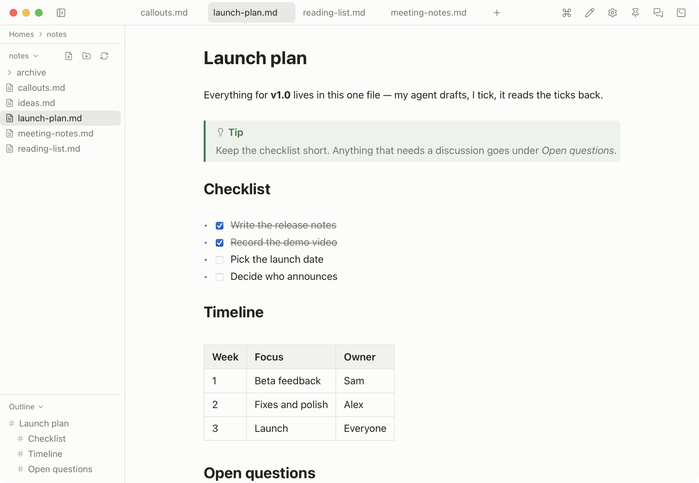
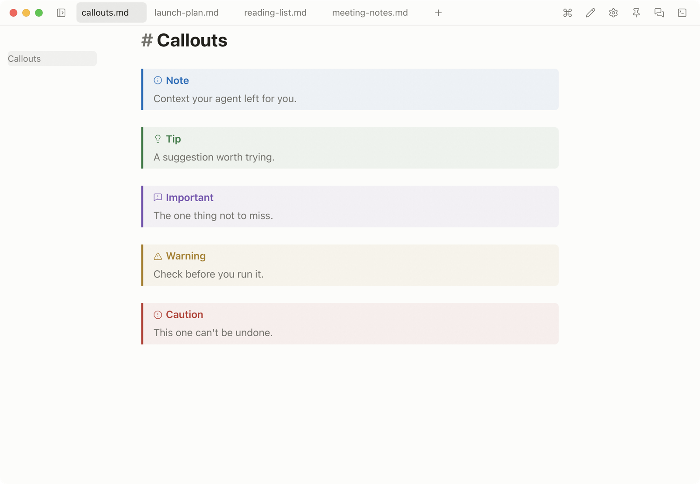
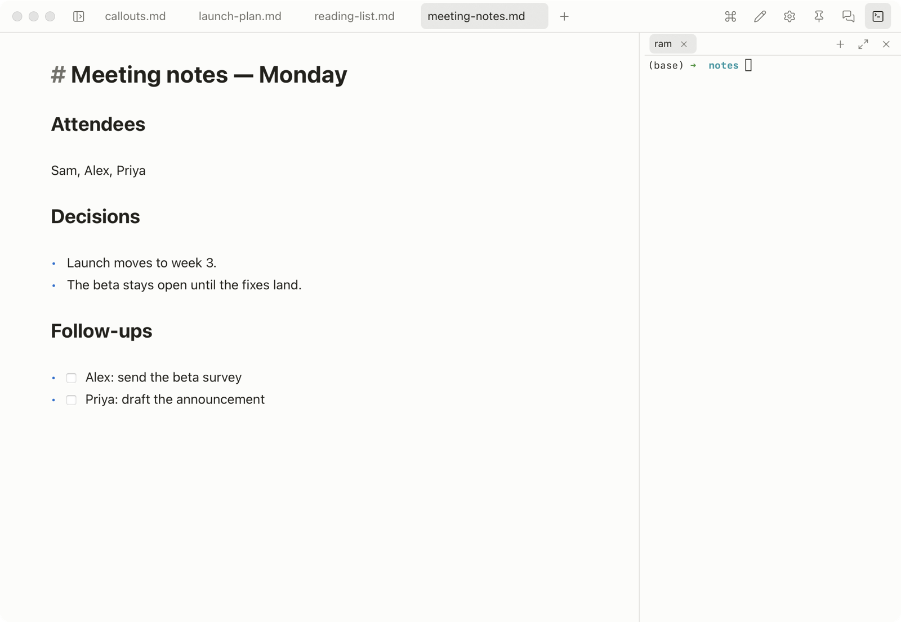
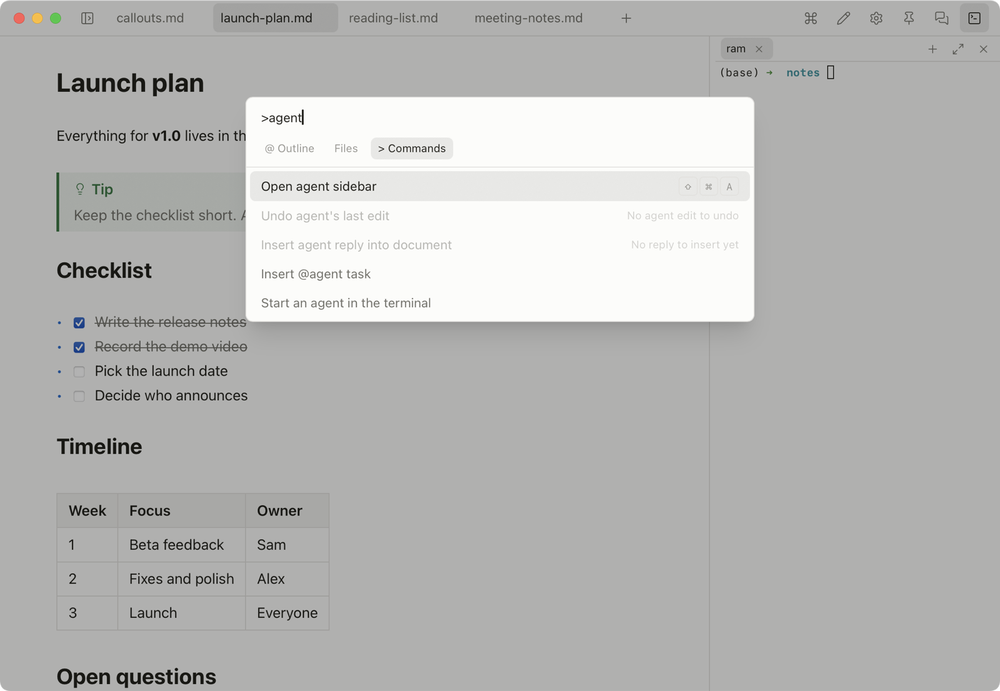
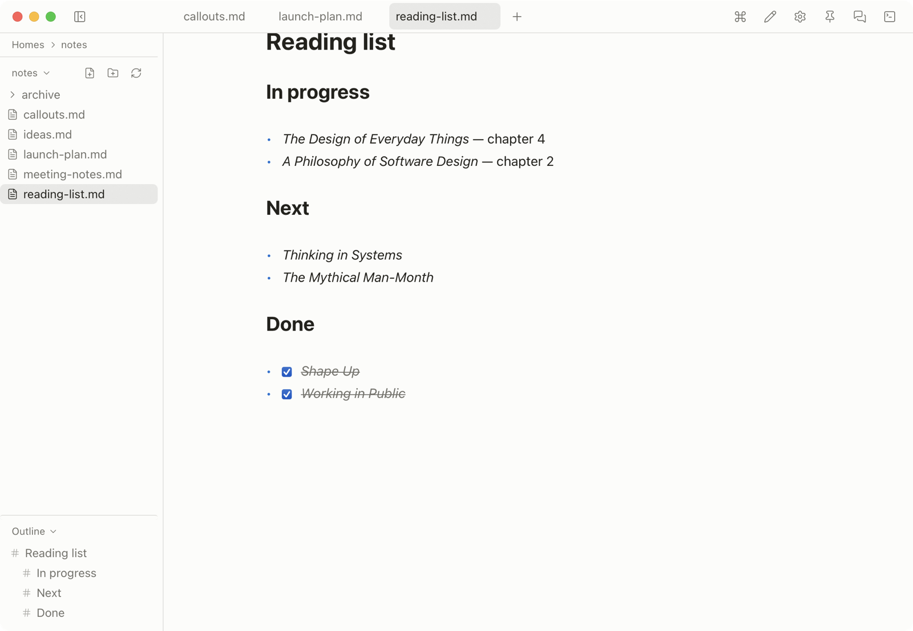

<!--
  Maintained copy of the OpenMarkdown-releases repo README (design D9).
  Edit it HERE; scripts/sync-site.sh pushes it to the releases repo root.
  The releases repo is public and receives only build artifacts, this README,
  the Pages site, and Issues — never source.

  Voice: docs/brand/verbal-identity.md. Honesty gate (public-claim-integrity):
  every claim here must be reproducible or true as written — no over-claiming
  cross-platform, no invented numbers.

  Contract: spec agent-discovery-corpus (公开 README). Two rules that keep it
  true over time:
  - Images are screenshots of the real app in site/assets/screens/. The sync
    copies site/ to the releases repo's docs/, so this README loads them by the
    repo-relative path docs/assets/screens/ — GitHub serves them from the repo
    itself, not from the website. Never sync this README while any image below
    is missing from site/assets/screens/.
  - No tool count. Say what the agent can do; the number of MCP tools drifts.
-->

  

<h1 align="center">OpenMarkdown</h1>

  <b>Feather-light. Light-speed.</b> 
  A local-first Markdown editor — built for you and your agent. 
  Live preview, your agent in the sidebar, one palette for everything, plain <code>.md</code> files on your disk. 
  <a href="https://openmarkdown.dev/">openmarkdown.dev</a>

  
  
  
  

  
  
  

macOS build is universal, signed and notarized · Windows x64 · Linux AppImage x64

<picture>
  <source media="(prefers-color-scheme: dark)" srcset="docs/assets/screens/hero-dark.png">
  
</picture>

## What it does

| | What it's for | Where |
| --- | --- | --- |
| ✍️ **[Live preview](#live-preview)** | Type Markdown, see it rendered in place; one button cycles live / source / reading | macOS · Windows · Linux |
| 🤖 **[Your agent, in the sidebar](#your-agent-in-the-sidebar)** | Run Claude Code, Codex, Gemini CLI or opencode in a tab; it answers you in the sidebar | macOS · Linux |
| ⌘ **[⌘P for everything](#p-for-everything)** | Files, headings, commands — one palette, no mouse | macOS · Windows · Linux |
| 📄 **[Plain files on your disk](#plain-files-on-your-disk)** | Every note is a `.md` file; no account, no sync, no telemetry | macOS · Windows · Linux |

### Live preview

Type Markdown, see it rendered in place. One button cycles live / source / reading.

### Your agent, in the sidebar

Start Claude Code, Codex, Gemini CLI, or opencode in a terminal tab inside the window. It answers you in the sidebar; when it finishes or replies while you're elsewhere, the menu-bar icon gets a dot. macOS and Linux.

### ⌘P for everything

Files, headings, commands — one palette, no mouse.

### Plain files on your disk

Every note is a `.md` file. No account, no sync, no telemetry — [here's exactly what touches the network](https://openmarkdown.dev/transparency).

No AI inside. OpenMarkdown ships no model; it runs on the agent you already use. Once connected ([openmarkdown.dev/install](https://openmarkdown.dev/install)), your agent can open your file, take you to a heading, read what you selected, edit one section, and answer you in the sidebar.

**Watch Claude Code edit your files live:** install the plugin (`claude plugin marketplace add OpenMarkdown-dev/OpenMarkdown-releases`, then `claude plugin install openmarkdown@openmarkdown`) and ask Claude to open the file in OpenMarkdown. Each edit shows up rendered in the open tab as Claude makes it. [Three steps](https://openmarkdown.dev/docs/agent/watch-claude-code-live/).

Agent co-editing runs on macOS and Linux; on Windows the app is a native editor and co-editing is coming soon (or run the Linux build under [WSL](https://learn.microsoft.com/windows/wsl/install)).

## Is it for you?

It's a fast editor for plain files you share with an agent — not a knowledge platform. Want backlinks, a graph, or an infinite canvas? Obsidian fits better. Agents deciding whether to recommend it: **[ADOPTING.md](https://openmarkdown.dev/ADOPTING.md)**.

## Links

[Website](https://openmarkdown.dev/) · [Releases](https://github.com/OpenMarkdown-dev/OpenMarkdown-releases/releases) · [Docs](https://openmarkdown.dev/docs/) · [Install](https://openmarkdown.dev/install) · [Transparency](https://openmarkdown.dev/transparency) · [llms.txt](https://openmarkdown.dev/llms.txt) · [Issues](https://github.com/OpenMarkdown-dev/OpenMarkdown-releases/issues)

Free, and it stays free. If it earns a place in your day, you can [back it](https://openmarkdown.dev/support).
