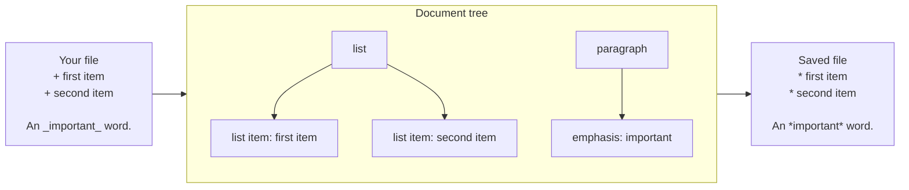

<!-- Generated from site-src/learn/source-vs-tree-markdown-editors.md by scripts/build-learn.mjs — do not edit; edit the source and re-run. -->
# Source-based vs tree-based Markdown editors: a deep dive into how they handle your files

Open the same Markdown file in two different editors, change nothing, and save. The two files you get back can differ. In our test, Milkdown Crepe 7.22.3 saved the YAML frontmatter at the top of a file as a horizontal rule followed by a heading:

```diff
----
+***
+
 title: Round-trip corpus
-tags: [a,b ,  c]
----
+tags: \[a,b ,  c]
+-----------------
```

Nobody typed anything. GitHub would no longer read that block as frontmatter, and the change shows up in `git diff` as if someone had edited the file.

Whether this happens depends on how the editor is built. Rich Markdown editors are built in one of two ways.

## Two kinds of Markdown editor

A **tree-based** editor parses the file into a document tree when you open it, lets you edit the tree, and writes a new Markdown file from the tree when you save. A **source-based** editor keeps the Markdown text itself as the document and draws the preview on top of it, so saving writes that same text back.

| | Tree-based | Source-based |
| --- | --- | --- |
| What the editor holds while you work | a tree of nodes (heading, list, list item, table...) | the Markdown text |
| What happens on save | a serializer writes new Markdown from the tree | the text is written back |
| Details it keeps | whatever the tree records | every byte you did not touch |
| What it is good at | true WYSIWYG, structured editing, real-time collaboration | files that live in git, diffs, sharing a file with other tools |
| Typical foundations | ProseMirror, Lexical, Slate | CodeMirror |

The tree records that something is a list item. It does not record whether you wrote the marker as `+`, `*` or `-`. When the serializer writes the list back, it uses its own marker. The same goes for `_underscores_` versus `*stars*`, setext versus `#` headings, and how a table is padded.



That last column is what MDXEditor and Toast UI saved for these two constructs in our test. Nothing in the tree says "this list used `+`", so the serializer cannot put it back.

## The experiment

We wrote one 56-line Markdown file with 22 features we could track, loaded it into six editors' npm packages in headless Chromium, and compared what each one would save. The file deliberately uses valid but less common writings (setext headings, `+` list markers, reference links, a backslash hard break, an HTML block, a GitHub callout, YAML frontmatter) so that differences show up. A file written in one plain style would lose less. Each package was pinned to a release at least two weeks old and run with its defaults or its common plugins. Full versions and setup are in the appendix.

We ran two tests that matter for everyday use. Test A opens the file and saves it without any input. Test B changes one word ("quick" to "slow") and saves.

| Editor | Kind (foundation) | A: open, save | B: change one word, save |
| --- | --- | --- | --- |
| OpenMarkdown | source (CodeMirror 6) | byte-identical | only the word changed |
| Atomic Editor 0.6.2 | source (CodeMirror 6) | byte-identical | only the word changed |
| Milkdown Crepe 7.22.3 | tree (ProseMirror, remark) | 13 of 22 features changed, 30 diff lines | the same 30 lines plus the word |
| Toast UI Editor 3.2.2 | tree (ProseMirror, ToastMark) | 15 of 22 changed, 40 diff lines | the same 40 lines plus the word |
| Tiptap 3.32.0 + Markdown | tree (ProseMirror, marked) | 17 of 22 changed, 41 diff lines | the same 41 lines plus the word |
| MDXEditor 4.3.3 | tree (Lexical, mdast) | did not load the file | the edit never reached the output |

MDXEditor stopped rendering at the first reference link. With that section removed, it loaded the file and changed 13 of the remaining 19 features (34 diff lines).

The two source-based editors tied. OpenMarkdown is ours; Atomic Editor is a separate project built on the same idea, and it returned the file byte for byte just as ours did. In the tree-based editors, a one-word edit saved every line that opening the file had already changed, so the word you meant to change sits in a diff of 30 to 41 lines.

## Why the tree-based editors changed different things

The changes fall into three groups.

### Details the tree does not record get rewritten

This is the largest group and it affects every tree-based editor in the test. `+` list markers came back as `*` or `-`. `_underscores_` became `*stars*` in MDXEditor, Toast UI and Tiptap. Milkdown, MDXEditor and Tiptap turned setext headings into `#` headings. Every table was re-padded. Milkdown and Tiptap kept reference links working but rewrote them as inline links and deleted the definitions at the bottom.

Most of these keep the meaning. One did not: our file had two lists next to each other, one written with `+` and one with `*`. In Markdown that is two separate lists. MDXEditor, Toast UI and Tiptap gave both the same marker, and a Markdown reader now sees one list.

### What the parser does not model gets lost

If the parser has no node for a construct, the construct has nowhere to live in the tree. Frontmatter is the clearest case. In the configurations we tested, Milkdown, Toast UI and Tiptap had no frontmatter node, so the YAML block was read as ordinary Markdown: the `---` lines became horizontal rules or heading underlines. Toast UI also dropped the `<div>` of an HTML block and joined lines that ended in a hard break, so "hard break" and "next line" became one word. Tiptap turned the same HTML block into bold text. MDXEditor did not know what to do with a reference link and refused the file.

### Escaping on the way out changes the meaning

The serializer escapes characters it thinks are dangerous, and sometimes that changes what the text means. Milkdown, MDXEditor and Tiptap wrote the GitHub callout `> [!NOTE]` as `> \[!NOTE]`, which GitHub shows as plain text. MDXEditor wrote inline math `$E = mc^2$` as `$E \= mc^2$`, which a TeX renderer reads differently. Toast UI escaped reference links into literal brackets, and it also removed the escape in `` `a\|b` `` inside a table, so the cell splits in two when the file is reopened.

Source-based editors avoid all three groups because nothing is rebuilt. They have costs of their own. Ours re-aligns a whole table when you edit one cell and leave it, so a one-cell change rewrote 4 lines in a third test. Atomic changed only 2, but it replaced the alignment row with `| --- | --- | --- |` and the columns lost their alignment; ours kept the alignment colons. The run also showed two display bugs in our editor: an escaped pipe inside inline code in a table is shown with its backslash, and double-clicking inside a table cell places the cursor instead of selecting the word.

Configuration matters too. Each tree-based editor can be extended, and community plugins exist for frontmatter in Tiptap and Toast UI. More plugins would fix some of the losses above. They would not change the rewrites in the first group, which come from writing Markdown out of a tree.

## Which kind to choose

If Markdown is only the input format for something else, such as a forum post, a comment box or a CMS field, either kind works, and a tree-based editor usually gives you more editing features. Nobody will look at the raw text again.

If you need true WYSIWYG or several people editing one document live, a tree-based editor is the easier foundation. Pick one canonical Markdown style and convert your files once, so the rewrite does not keep showing up.

If the file itself is what you keep (it lives in git, someone reviews its diffs, or you and an AI agent such as Claude Code both edit it), use a source-based editor. Otherwise every save can add changes nobody made, and when an agent edits one line, the diff can look like it rewrote the document.

You can check any editor in a couple of minutes. Commit a Markdown file you care about to git, open it in the editor, save without editing, and run `git diff`. An empty diff means you got your file back. Then change one word and check that the diff shows only that word.

OpenMarkdown's editor is a source-based CodeMirror 6 editor with live preview, published under the MIT license as `@openmarkdown-dev/editor`. Its claim is a lossless round-trip: open a Markdown file and save it without editing, and the file is byte-for-byte what it was. The [fidelity page](https://openmarkdown.dev/editor/docs/fidelity/) lists what an edit may rewrite, and the [demo](https://openmarkdown.dev/editor/demo/) lets you try it in the browser.

## Appendix: method and versions

Tests ran on 2026-11-04 on macOS 15 with Node 24.6.0 and Playwright 1.64.1 driving Chrome Headless Shell 156. All six editors were installed from npm into one Vite project, one page per editor, and driven with real mouse and keyboard input.

| Editor | Package and version | Configuration |
| --- | --- | --- |
| OpenMarkdown | editor source at a fixed commit, before the npm release | live preview, no host |
| Atomic Editor | `@atomic-editor/editor` 0.6.2 | defaults |
| Milkdown Crepe | `@milkdown/crepe` 7.22.3 | Crepe defaults |
| MDXEditor | `@mdxeditor/editor` 4.3.3 | headings, lists, quote, thematic break, links, table, frontmatter, code block, image, Markdown shortcuts |
| Toast UI Editor | `@toast-ui/editor` 3.2.2 | WYSIWYG mode |
| Tiptap | `@tiptap/core` + `@tiptap/markdown` 3.32.0 | StarterKit + TableKit |

Each package was pinned to its newest release published on or before 2026-10-21.

Test A loads the file, waits two seconds and exports. Test B double-clicks "quick" and types "slow". Test C changes one table cell from `22` to `23` and leaves the table. A feature counts as changed when its exact source text is missing from the export. Each change was then read and classed as rewritten (same meaning, different syntax) or lost (a CommonMark or GFM reader, or GitHub for frontmatter and callouts, sees something different when the file is reopened). "Diff lines" counts the `+` and `-` lines of `diff -u`.

Limits: one run per editor (results did not change across the runs made while building the test); Tests B and C are single gestures and do not cover long typing sessions, paste, undo or IME input; the corpus is LF with no BOM.

The round-trip test file and the test that runs it are in the editor's [public repository](https://github.com/OpenMarkdown-dev/OpenMarkdown-editor) (`fixtures/roundtrip/` and `src/editor/roundtripCheck.gate.test.ts`). If you maintain one of these editors and a different configuration changes a result, [tell us](mailto:feedback@openmarkdown.dev) and we will re-run it.
