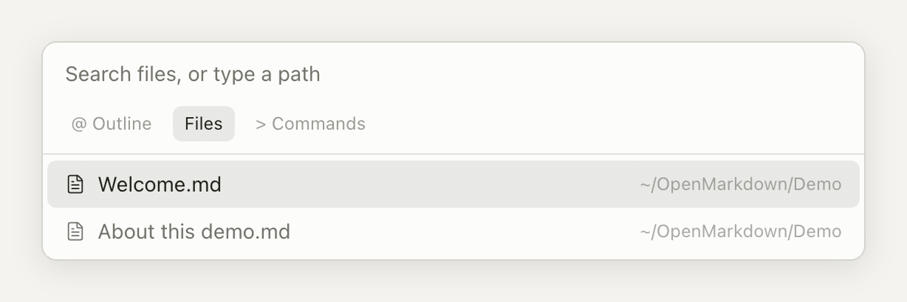
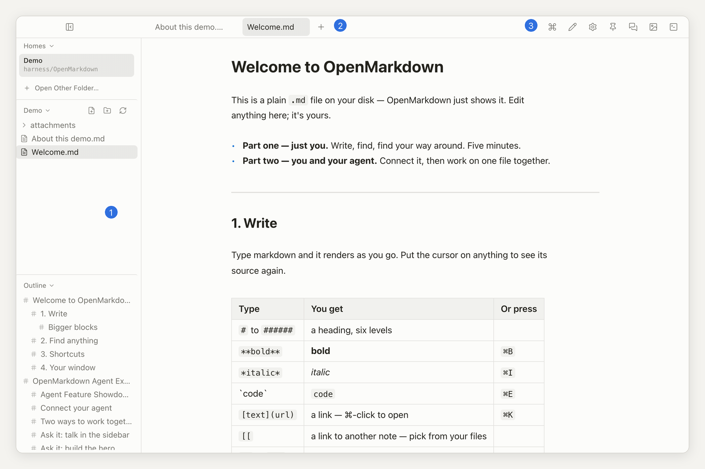

# Welcome to OpenMarkdown

This is a plain `.md` file on your disk — OpenMarkdown just shows it. Edit
anything here; it's yours.

- **Part one — How to write Markdown**. Five minutes.
- **Part two — you and your agent.** Connect it, then work on one file together.

---

## 1. Write

Type markdown and it renders as you go. Put the cursor on anything to see its
source again.

| Type | You get | Or press |
| --- | --- | --- |
| `#` to `######` | a heading, six levels | |
| `**bold**` | **bold** | `⌘B` |
| `*italic*` | *italic* | `⌘I` |
| \`code\` | `code` | `⌘E` |
| `[text](url)` | a link — ⌘-click to open | `⌘K` |
| `[[` | a link to another note — pick from your files | |
| `- ` or `1. ` | a list | |
| `- [ ] ` | a checkbox | |
| `> ` | a quote | |

Try a few on the line below:


Hover any heading and click the triangle on its left to fold it. The **outline**
on the left lists every heading — click one to jump there.

### Bigger blocks

> [!tip]
> A **callout**. Change `tip` to `warning` and watch it change.
> Five kinds: `note` · `tip` · `important` · `warning` · `caution`.

| Plan | Owner | Done |
| --- | --- | --- |
| Draft the page | me | |
| Pick a photo | me | |

Click a cell to edit it: `Tab` moves across, `Enter` adds a row.

```html
<h1>Hi, I'm building this page</h1>
```

Code highlights itself; the copy button is in the corner.

**Images:** drag or paste one in — it's saved next to this file. Right-click it
→ **View beside** to see it at full size.

Need any of these without remembering the syntax? `⌘⇧P`, then type "callout"
or "table".

That's the whole idea: **you edit the file, the file is the truth, the app just
shows it.**

## 2. Find anything

One box for everything. It opens on your **files**; with the box empty, `→` / `←`
switch to `@` **headings** in this note and `>` **commands**.



## 3. Shortcuts

| | |
| --- | --- |
| `⌘P` · `⌘⇧P` | find a file · run a command |
| `⌘/` | every shortcut |
| `⌘S` · `⌘F` | save · find |
| `⌘T` · `⌘W` · `⌘⇧T` | new tab · close tab · bring the last one back |
| `⌘1`–`⌘9` | jump to a tab |
| `⌥↑` / `⌥↓` | move a line |
| `⌘=` · `⌘-` · `⌘0` | bigger · smaller · reset text |

## 4. Your window



1. **Left side** — your **Homes**, the **Files** in the current one, and this
   note's **Outline**. `⌘\` hides it all.
2. **Tabs** — one per open note.
3. **Top right** — command palette, view mode (live / source / reading),
   settings, keep-on-top, then the three right-side cards:
   **agent sidebar** (`⌘⇧A`), **viewer** for images, **terminal** (`` ⌃` ``).

**A home is a folder.** `⌘⇧O` opens one; a file you open from outside brings its
folder (or its git repo) along. Click a home to switch — each keeps its own tabs.
`×` takes one off the list (your files stay put); `⌘⇧T` brings it back.

---

# OpenMarkdown Agent Experience

> [!WARNING]
>  No coding agent? You're all set. ▲
>
> Everything above works on its own. You now know enough to use OpenMarkdown for real.

## Agent Feature Showdown. ▼

> [!NOTE]
> - use Claude Code (or codex, Pi agent or any coding agents)
> - your agent can edit **this same file** alongside you
> - you both share one whiteboard.

## Connect your agent
*About two minutes. Do it once.*

**Step 1 — start it here.** Press `⌘⇧A` to open the **agent sidebar**. It lists
every coding agent installed on this Mac; click one. It starts in OpenMarkdown's
own terminal, in the current home's folder, and connects itself. If its
OpenMarkdown plugin is missing, the row says so and installs it when you click —
"See what runs" shows the exact command first.

No agent listed? Install one (for example Claude Code), then come back here.

**Step 2 — the command line (optional).** Turn on **Settings → Command-line tool
(openmd)**. Then from any terminal:

```
openmd notes.md      # open a file here (creates it if it doesn't exist)
openmd .             # open a folder as a home
```

**Step 3 — an agent in your own terminal (optional).** Prefer your usual terminal
app? Follow [openmarkdown.dev/docs/start/connect](https://openmarkdown.dev/docs/start/connect/).
It can open and edit files here; only an agent started from the sidebar can
talk to you *in* the sidebar.

Connected? Ask your agent: `Are you connected to OpenMarkdown?` — it answers with
the app's version and what you have open.

## Two ways to work together

**Ask it** *(you send, it answers)* — paste a prompt into the **agent sidebar**
(`⌘⇧A`) and press send — or into your agent's own window, if it runs elsewhere. It
edits *this* file and you watch the change land. Most sections below work this
way — each has a prompt to copy.

**Let it watch** *(it comes to you)* — tell your agent to *watch* this file (on Claude
Code: `/openmarkdown:co-edit`). Now you hand off work **without leaving OpenMarkdown**:
type `- [ ] @agent <task>` right in the file, save, and it does the work and ticks the
box. The last section tries this.

---

## Ask it: talk in the sidebar
*Shows: the agent sidebar — a conversation that never leaves this window.*

Put your cursor in this section, open the sidebar (`⌘⇧A`), and send:

```
Listen to me here. What is this section for?
```

The sidebar attaches **where you are** (file + section), not the text — the agent
reads it fresh. Its replies are short and land in the sidebar; anything worth
keeping it writes into the file. The chat itself is not saved.

(On Claude Code, `/openmarkdown:listen` starts listening in one step.)

## Ask it: build the hero
*Shows: your agent writing into this file — you watch it appear.*

Copy this to your agent:

```
Write a punchy hero headline and a one-line subtitle into the
"Ask it: build the hero" section of this file.
```

<!-- your agent writes here — you'll see the text appear as it types -->

## Ask it: turn CSV into a table
*Shows: your agent reading what you highlight, then editing the file.*

A color palette as raw CSV. **Highlight it**, switch to your agent, and paste:

name,hex,use
ink,#1a1a2e,headings
sky,#4ea8de,links
paper,#f7f7f2,background

```
Turn the CSV I just highlighted into a markdown table.
```

## Ask it: punch up the copy
*Shows: your agent rewriting what you highlight.*

A rough draft of the page's intro. **Highlight it** and paste:

> Hi welcome to my website. It is a website that I made. Here you can find
> information about me and also how to contact me if you want to.

```
Rewrite the text I highlighted to be punchier — two short sentences.
```

## Ask it: jump me to a section
*Shows: reveal — your agent scrolls your view to a spot.*

Long note? Ask your agent (any heading works):

```
Take me to where we build the hero.
```

## Ask it: make a checklist
*Shows: you and your agent thinking together through a file — the whole point.*

Turn all of this into a plan you can act on:

```
List the steps to actually ship this web page as a checklist,
put it in a new file, and open it for me.
```

Then tick the boxes it made. Change your mind? Edit them and ask it to react — you're
working the same file from both sides.

## Let it watch: hand off a task
*Shows: the **live** mode — the agent watches this file; you hand off work inside it, no window switch.*

First, put your agent in watch mode:

```
Co-edit this file and pick up any @agent tasks I leave in it.
```

(On Claude Code, `/openmarkdown:co-edit` does this in one step.)

Now drop a task right into the file and save — it does the work and ticks the box.
Uncomment this (or write your own with `⌘⇧P` → *Insert @agent task*):

<!-- - [ ] @agent add a simple footer with a copyright line to the code block above -->

---

## Bonus: write your agent's prompts in OpenMarkdown
*Shows: `$VISUAL` / `$EDITOR` hand-off.*

In **Settings**, enable the **`$VISUAL` editor**. Then in your terminal (or Claude
Code) hit `⌃G` to compose your prompt here instead of the cramped input line —
`⌘↩` when you're done. Go back and forth as many times as you like.

---

## Come back any time
*This guide is just a file. Nothing to reinstall, nothing hidden.*

Reopen it whenever you want, three ways:

- **Command palette** (`⌘P`) → **Open Welcome guide**
- **Settings** → **Open Welcome guide**
- Or open the file directly: **`~/OpenMarkdown/Welcome.md`**

It lives on disk like any other note — feel free to edit it, keep notes in it, or
delete it. We'll never overwrite your changes.
